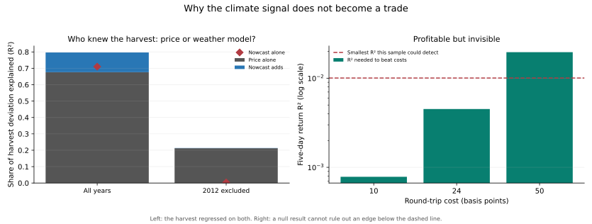

# Why the climate signal does not become a trade

Every return test in this repository reports approximately zero or negative out-of-sample skill. That result is consistent with several different worlds, and the backtests cannot tell them apart on their own. Two of them are separated here: the information was already in the price, and the sample was too small to see an edge worth having.

## Test one: was the weather already in the price?

The race is run on the **harvest**, not on returns. Regressing returns on a signal asks whether the signal predicts the price, which every backtest here already answered. Regressing the realised yield deviation on the published nowcast, on the contemporaneous new-crop price change, and on both together asks who knew what — the question that separates an efficient market from a useless model.

The price signal is the log change in the new-crop December contract from April 1 to the issue date: how much the market marked that harvest up while it was being grown. The dated contract is the right instrument, and the continuous front month is reported alongside it only because it reaches further back. Nothing is refit: the forecasts are read from the committed nowcast prediction file.

| Sample | Issue | Price source | Harvests | Nowcast R² | Price R² | Joint R² | Nowcast adds | Drop-one range | Nowcast β kept | β excludes 0 |
|---|---|---|---:|---:|---:|---:|---:|---|---:|---|
| all_years | 08-01 | Continuous front month | 16 | +0.682 | +0.380 | +0.767 | +0.387 | +0.327 to +0.455 | 83% | yes |
| exclude_2012 | 08-01 | Continuous front month | 15 | +0.079 | +0.130 | +0.173 | +0.043 | +0.013 to +0.142 | 76% | no |
| all_years | 08-01 | New-crop December contract (dated) | 14 | +0.710 | +0.676 | +0.797 | +0.120 | +0.082 to +0.188 | 61% | no |
| exclude_2012 | 08-01 | New-crop December contract (dated) | 13 | +0.004 | +0.212 | +0.214 | +0.001 | +0.000 to +0.073 | -63% | no |



**Largely, yes.** Across all years the nowcast explains 0.710 of the harvest deviation and the December price 0.676; together they reach 0.797, so they are mostly explaining the same thing. What the nowcast adds on top of the price is +0.120, its coefficient keeps 61% of its standalone value once the price is included, and the whole-harvest bootstrap on that coefficient does not exclude zero.

Removing 2012 and refitting leaves the nowcast explaining +0.004 against the price's +0.212, with an incremental contribution of +0.001. On the thirteen remaining harvests the weather model adds essentially nothing to what the futures price already said, and the price retains the larger share of what little is explained.

The two price sources disagree, and the disagreement is interpretable rather than troubling. On the continuous front month the nowcast's incremental contribution is +0.387 and its coefficient does survive the bootstrap. But in August the front month is a mixture of old and new crop carrying roll artefacts, so it is a worse statement of new-crop expectations and leaves more room for the weather model to look informative. The cleaner instrument is the one that subsumes the signal, which is the direction an efficiency argument predicts.

## Test two: could this sample have seen a tradeable edge?

A strategy needs only a small edge to beat costs, and a small edge needs a large sample to separate from zero. Those two thresholds are different quantities and are computed separately here. Break-even assumes a position taking the sign of the forecast on jointly normal draws, where expected gross profit per trade is `sd × sqrt(2/π) × correlation`. Detection uses the conventional 5% two-sided test at 80% power. Only non-overlapping returns are counted, because overlapping windows are not independent observations.

### Growing-season return dispersion

| Horizon | SD | Overlapping | Independent | Window |
|---|---:|---:|---:|---|
| 1-day | 0.0196 | 3910 | 3910 | 2000-07-18 to 2026-09-25 |
| 5-day | 0.0448 | 3906 | 781 | 2000-07-24 to 2026-09-25 |
| 10-day | 0.0636 | 3901 | 390 | 2000-07-31 to 2026-09-25 |

### What pays, against what could be measured

| Horizon | Independent draws | Cost | Break-even R² | Detectable R² | Draws needed | Shortfall | Blind? |
|---|---:|---:|---:|---:|---:|---:|---|
| 1-day | 3910 | 10 bps | 0.00411 | 0.00201 | 1,911 | 0.5× | no |
| 1-day | 3910 | 24 bps | 0.02367 | 0.00201 | 332 | 0.1× | no |
| 1-day | 3910 | 50 bps | 0.10272 | 0.00201 | 77 | 0.0× | no |
| 5-day | 781 | 10 bps | 0.00078 | 0.01005 | 10,019 | 12.8× | **yes** |
| 5-day | 781 | 24 bps | 0.00451 | 0.01005 | 1,740 | 2.2× | **yes** |
| 5-day | 781 | 50 bps | 0.01959 | 0.01005 | 401 | 0.5× | no |
| 10-day | 390 | 10 bps | 0.00039 | 0.02013 | 20,183 | 51.8× | **yes** |
| 10-day | 390 | 24 bps | 0.00224 | 0.02013 | 3,504 | 9.0× | **yes** |
| 10-day | 390 | 50 bps | 0.00972 | 0.02013 | 808 | 2.1× | **yes** |

At five days and 10 basis points a sign rule breaks even at an R² of 0.00078, while the 781 independent growing-season returns in this archive can only distinguish an R² of 0.01005 from zero — a factor of 13. Detecting the break-even edge would need about 10,019 independent observations, 13 times what exists.

**So there is a band of signal strengths that would be profitable and invisible**, and a null result cannot rule them out. Every cost level marked *yes* above sits in that band.

## What this does and does not excuse

The power budget is a statement about the experiment's resolution, not a defence of its result, and it would be a misreading to take it as one. The backtests in this repository did not merely fail to reach significance. The locked USDA Crop Progress model lost 52.7% after costs, the sealed GEFS holdout lost 7.3% with −0.98 Sharpe, and the frozen signal's next-open replay returned −7.1%. A true edge too small to detect produces results scattered near zero; it does not produce losses of that size. Those outcomes are evidence against a positive edge in their own right, and they are consistent with the execution attribution's finding that real per-contract costs removed far more than the ten-basis-point bridge assumed.

Read together, the two tests give a specific answer to why the climate signal does not translate into profitable trades. The information is largely public and already impounded in the new-crop price by the time a weather model can compute it, so there is little left to trade. Whatever remains is smaller than this sample can measure at realistic costs, so no amount of further modelling on this archive could establish it. And the executed attempts lost money rather than hovering near zero, which is the strongest of the three signs.

## Limits

The horse race has fourteen harvests on the dated contract and sixteen on the continuous series, so every R² in it is a small-sample quantity and the all-years figures are visibly carried by 2012 — the drop-one columns show by how much. A four-month price change is one summary of market expectations among many; options-implied distributions and the old-crop/new-crop spread are not tested. The break-even arithmetic assumes normality and an every-period sign rule, while the project's models hold sometimes, which trades breadth against cost. The power calculation treats non-overlapping returns as independent, which ignores remaining seasonality and volatility clustering and so is optimistic about the sample. No model is refit, no trading specification is changed, and no sealed holdout is opened.

## Reproduce

```bash
PYTHONPATH=src python analysis/corn_price_information.py
```

Requires the nowcast evaluation to have been run first. Use `--data-root`, `--output-dir`, and `--cost-bps` to vary the assumptions. Inspect the [horse race](corn_price_information_race.csv), [price signals](corn_price_information_signals.csv), [return moments](corn_price_information_moments.csv), and [power budget](corn_price_information_budget.csv). Input fingerprints:

- `yahoo_prices_daily`: `3503fe1ad763a36c540adf749c1727d59b434dd166f22bf3257a003ac76f7ffc`
- `futures_contracts`: `03162fe8ead6dc7b216d4d36483a61ea0f2364575e7ec1f53eead27ecbc1aa8a`
- `corn_yield_nowcast_predictions.csv`: `7f822472a211f76f4178e30c48502b6c3d1f29c37df7dbcfcf1d0cbcfe466010`
