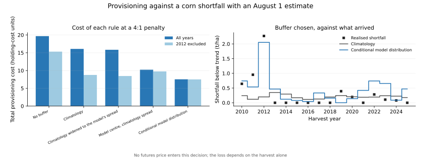

# Using the corn supply-risk estimate to provision against a shortfall

## Who this is for

The project's two headline findings only conflict for a speculator. Public weather measures a corn supply shock, and the same information produces no futures-return edge. A grain buyer, feed mill, ethanol plant, or agricultural lender already holds that exposure whether or not they forecast it, and what a better forecast buys them is a lower chance of being caught short — not a trading profit. That benefit survives in a perfectly efficient market, so it is the use this project's evidence can actually support.

## The decision, and why no price appears in it

A demonstration that let its user size a futures position from the model would be reimporting the directional signal that failed every validation here, and reporting that failure as a profit. **No price enters this analysis.** The user provisions a physical buffer against a shortfall in the crop they must handle; the loss depends on the harvest alone.

Each August the user commits a buffer against the shortfall below that fold's own trend forecast. Provisioning less than the shortfall costs `penalty` per tonne per hectare short; provisioning more costs one unit per tonne carried. Under that loss the optimal buffer is the `penalty / (penalty + 1)` quantile of the predictive shortfall distribution, so a better distribution shows up directly as a better buffer. **The asymmetry is a stated preference, not an estimate**, and results are reported at 2:1, 4:1, 8:1. Costs are in units of the holding cost; converting to currency multiplies every strategy by the same constant and changes no ranking.

Every buffer uses only earlier harvests, with at least 10 of them, and the predictive distributions come from the same chronological folds as the calibrated intervals.

## The strategies, and the control that matters

`climatology` is what the user can do with no weather data at all: the training years' own deviations from trend. `model` uses the conditional conformal distribution. `model_point_only` keeps the model's centre but borrows climatology's spread, separating knowing where the distribution sits from knowing how wide it is.

`climatology_scaled` is the control this design needs. An asymmetric loss rewards a wider predictive distribution for its own sake, because over-provisioning is the cheap error, so a model that is merely more uncertain than climatology would post a saving that has nothing to do with information. This strategy hands the no-weather user the model's uncertainty without the model's information. A saving that is really just conservatism appears here too.

## Predeclared expectation

Stated before the numbers and not revised after them: the decomposition report found the model's skill concentrated in the seasons furthest from trend, and the interval report found its coverage of 2012 marginal and its August calibration understated. The saving was therefore expected to concentrate in 2012 and to shrink substantially in the refitted run without it. A saving that survived 2012's removal would be the stronger result; one that did not would mean the estimate is not yet decision-grade outside catastrophic seasons.

## Results: the August 1 decision

Information set `points_drought` at August 1 — the only one of these a buyer could actually use. Sixteen harvests, or fifteen without 2012.

| Sample | Penalty | Strategy | Total cost | Mean | CVaR (80%) | Mean buffer | Years short | vs climatology |
|---|---:|---|---:|---:|---:|---:|---:|---:|
| all_years | 2:1 | Climatology (no weather data) | 9.44 | 0.590 | 2.357 | 0.072 | 6 | +0.0% |
| all_years | 2:1 | Climatology widened to the model's spread | 9.19 | 0.574 | 2.323 | 0.058 | 8 | +2.6% |
| all_years | 2:1 | Conditional model distribution | 5.64 | 0.352 | 1.164 | 0.238 | 6 | +40.3% |
| all_years | 2:1 | Model centre, climatology spread | 5.48 | 0.343 | 1.311 | 0.166 | 7 | +41.9% |
| all_years | 2:1 | No buffer | 9.84 | 0.615 | 2.577 | 0.000 | 8 | -4.2% |
| all_years | 4:1 | Climatology (no weather data) | 16.08 | 1.005 | 4.411 | 0.204 | 5 | +0.0% |
| all_years | 4:1 | Climatology widened to the model's spread | 15.84 | 0.990 | 4.300 | 0.155 | 6 | +1.5% |
| all_years | 4:1 | Conditional model distribution | 7.54 | 0.471 | 1.367 | 0.440 | 4 | +53.1% |
| all_years | 4:1 | Model centre, climatology spread | 10.23 | 0.639 | 2.425 | 0.223 | 6 | +36.4% |
| all_years | 4:1 | No buffer | 19.68 | 1.230 | 5.154 | 0.000 | 8 | -22.4% |
| all_years | 8:1 | Climatology (no weather data) | 29.11 | 1.819 | 6.641 | 0.726 | 3 | +0.0% |
| all_years | 8:1 | Climatology widened to the model's spread | 24.96 | 1.560 | 6.374 | 0.523 | 3 | +14.2% |
| all_years | 8:1 | Conditional model distribution | 12.82 | 0.801 | 2.057 | 0.675 | 3 | +56.0% |
| all_years | 8:1 | Model centre, climatology spread | 14.69 | 0.918 | 2.219 | 0.667 | 4 | +49.5% |
| all_years | 8:1 | No buffer | 39.36 | 2.460 | 10.308 | 0.000 | 8 | -35.2% |
| exclude_2012 | 2:1 | Climatology (no weather data) | 6.37 | 0.425 | 1.310 | 0.090 | 8 | +0.0% |
| exclude_2012 | 2:1 | Climatology widened to the model's spread | 6.29 | 0.419 | 1.277 | 0.091 | 9 | +1.3% |
| exclude_2012 | 2:1 | Conditional model distribution | 5.19 | 0.346 | 1.063 | 0.147 | 8 | +18.6% |
| exclude_2012 | 2:1 | Model centre, climatology spread | 5.79 | 0.386 | 1.228 | 0.102 | 8 | +9.1% |
| exclude_2012 | 2:1 | No buffer | 7.66 | 0.511 | 1.498 | 0.000 | 9 | -20.2% |
| exclude_2012 | 4:1 | Climatology (no weather data) | 8.76 | 0.584 | 2.014 | 0.284 | 5 | +0.0% |
| exclude_2012 | 4:1 | Climatology widened to the model's spread | 8.45 | 0.564 | 1.918 | 0.287 | 5 | +3.5% |
| exclude_2012 | 4:1 | Conditional model distribution | 7.50 | 0.500 | 1.525 | 0.423 | 2 | +14.4% |
| exclude_2012 | 4:1 | Model centre, climatology spread | 9.75 | 0.650 | 2.011 | 0.253 | 6 | -11.3% |
| exclude_2012 | 4:1 | No buffer | 15.32 | 1.021 | 2.996 | 0.000 | 9 | -74.9% |
| exclude_2012 | 8:1 | Climatology (no weather data) | 14.50 | 0.967 | 2.958 | 0.556 | 3 | +0.0% |
| exclude_2012 | 8:1 | Climatology widened to the model's spread | 14.04 | 0.936 | 2.785 | 0.564 | 3 | +3.2% |
| exclude_2012 | 8:1 | Conditional model distribution | 12.40 | 0.827 | 2.155 | 0.666 | 2 | +14.5% |
| exclude_2012 | 8:1 | Model centre, climatology spread | 13.89 | 0.926 | 2.954 | 0.504 | 4 | +4.2% |
| exclude_2012 | 8:1 | No buffer | 30.64 | 2.043 | 5.993 | 0.000 | 9 | -111.3% |



## Is the saving just a wider buffer?

No. The model's residual spread averages 0.76 times the climatological spread across all years and 1.01 without 2012, so it is the *less* uncertain of the two and cannot be buying its advantage through conservatism. Widening climatology to match the model's spread does help a little, but the model still beats that control by +38.6% at 2:1, +52.4% at 4:1, +48.6% at 8:1 across all years, falling to +17.6%, +11.3%, +11.7% respectively once 2012 is removed.

## Uncertainty on the saving

Whole harvests are resampled, because a crop year is the independent observation and sixteen of them are too few for a point estimate to stand alone. A positive value is a saving against climatology.

| Sample | Penalty | Mean saving per harvest | 2.5% | Median | 97.5% | P(saving > 0) | Harvests better | Harvests worse |
|---|---:|---:|---:|---:|---:|---:|---:|---:|
| all_years | 2:1 | +0.237 | -0.017 | +0.215 | +0.649 | 95.0% | 7 | 6 |
| all_years | 4:1 | +0.534 | -0.147 | +0.476 | +1.672 | 88.0% | 8 | 8 |
| all_years | 8:1 | +1.018 | +0.061 | +0.941 | +2.683 | 98.4% | 12 | 4 |
| exclude_2012 | 2:1 | +0.079 | -0.052 | +0.079 | +0.218 | 86.8% | 8 | 7 |
| exclude_2012 | 4:1 | +0.084 | -0.238 | +0.075 | +0.451 | 66.3% | 8 | 7 |
| exclude_2012 | 8:1 | +0.140 | -0.236 | +0.115 | +0.645 | 70.5% | 6 | 9 |

## Interpretation

The predeclared expectation held. Across all years the conditional distribution cuts provisioning cost against the no-weather baseline by 40% at 2:1, 53% at 4:1, 56% at 8:1. Once 2012 is removed from training and evaluation and every fold is refitted, the same comparison falls to 19%, 14%, 14% respectively.

So the decision value behaves like the R², the interval coverage, and the severity strata before it: most of it is 2012. What remains after 2012 is removed is a double-digit point estimate rather than nothing, which is a better outcome than those earlier sections showed — but as the resampling below makes clear, fifteen harvests cannot separate it from zero.

Read against the resampling, the all-years saving excludes zero only at the 8:1 asymmetry and straddles zero at 2:1, 4:1. The one asymmetry where it is cleanly positive is the most risk-averse one, which is coherent rather than convenient: 2012 is precisely the season a buyer with an 8:1 penalty is afraid of, so that is where a tail-sensitive loss should find value.
Without 2012 every bootstrap interval straddles zero, with the probability of a saving running from 66% at 4:1 to 87% at 2:1 and the harvests improved barely outnumbering those made worse. On fifteen seasons that is not a detectable advantage, and it should not be quoted as one.
The regime split shows the shape of it. In the refitted run without 2012, at a 4:1 penalty, the model saves +1.81 cost units across the seasons that did fall short and loses 0.55 across those at or above trend, where its buffer was provisioned against a shortfall that never came. It behaves like an insurance instrument: it pays in bad years and charges a premium in good ones, netting +1.26 over the fifteen seasons. That net is positive, and it is also inside the bootstrap interval above — a point estimate worth reporting, not an effect this sample can establish.

The practical statement a commodity analyst can take from this project is therefore narrow and, within its limits, usable. An August estimate built from free public weather is worth having mainly as insurance against a 2012: it sizes a buffer better than climatology when the crop is genuinely failing, and adds little when it is not. It is not a source of edge against the futures market, and the supporting interval is wide enough — around ±8.7% of trend yield for the full season, more in season — that any provisioning decision has to be built around the spread rather than the central value.

The full-season rows in the committed CSVs are a bound rather than a decision. County weather is not published in time to inform an August commitment, as the nowcast report's availability audit established, so that information set measures what better-timed data would be worth and not what this archive can deliver.

## Limits

The loss function is a stated preference. A real buyer's penalty asymmetry, storage economics, basis exposure, and contractual obligations are all absent, and only the penalty ratio is varied here. The quantity is national yield per hectare rather than any particular firm's volume, so the costs are per-unit and notional. Harvests are revised historical values, not the vintages a decision would have faced at the time, and all sixteen have already informed this project, so this is a retrospective demonstration rather than a fresh holdout. No trading specification is touched and no sealed holdout is opened.

## Reproduce

```bash
PYTHONPATH=src python analysis/corn_yield_decisions.py
```

Use `--data-root` for an archived data directory, `--output-dir` for a separate destination, and `--penalty-ratios` to change the asymmetries. Inspect the [per-harvest decisions](corn_yield_decisions_decisions.csv), [strategy scores](corn_yield_decisions_scores.csv), [bootstrap](corn_yield_decisions_bootstrap.csv), [regime strata](corn_yield_decisions_strata.csv), and [spread diagnostic](corn_yield_decisions_spreads.csv). Input fingerprints:

- `nasa_power_point_daily`: `bcc37518341aac582cb60980a81e125f2501241388d7b2e1089cfba210a99c04`
- `nclimgrid_county_daily`: `cacd6bf7ea731e330ae238e20cae08cab88924929da00c28380e41e6813ea04c`
- `usdm_county_drought`: `7a95532a26652e00566fe32d82e3fdbe7c95513c876581e11ea71be9dce215fa`
- `owid_yields_annual`: `d7f57022ae166e30c136ba81527060b9fccca075e59ccd8d3796f3b783c32a0d`
- `config/sources.yaml`: `c7e6d521158dc5488520d52ac242190cf8bd3d4979d6ecebedcb74628206ee98`
- `config/geography.yaml`: `0d1884d0046e481b3e3bf9c316bb627139f902c2dfd144e7a9b9f78d578522c8`
