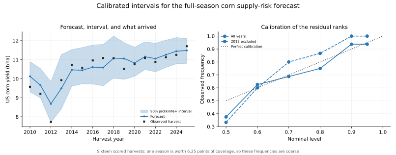

# Calibrated intervals for the corn yield forecasts

## What is being added, and to what

The forward and fixed-date evaluations publish a point forecast per harvest. A point forecast cannot serve as a supply-risk estimate, because it says nothing about how wrong it can be. This adds intervals around those same forecasts. No model, feature set, or alpha is refitted, retuned, or reselected: the point forecast reported for each harvest matches the committed prediction CSVs to floating-point tolerance, and a test asserts it.

## Method

Intervals are built with jackknife+ (Barber, Candès, Ramdas and Tibshirani, 2021). For each harvest the model trains on earlier seasons only, with at least 10 of them. Inside that training window each year is withheld in turn, the yield trend and the regression are both refitted without it, and the resulting residual joins the calibration set. Nothing that forecasts a harvest has seen it, and no leave-one-out residual is measured against a trend the withheld season helped define.

Split conformal was rejected for this sample. A strictly chronological calibration block supports a nominal level only once `ceil(level × (n+1)) ≤ n`, so 90% needs nine residuals and is unavailable until 2019 — leaving seven evaluable harvests, all in the calm recent era that the decomposition report shows carries the least information. Jackknife+ draws from each fold's training window instead, so every scored harvest gets a finite interval at both levels.

**The guarantee is weaker than the label.** Jackknife+ guarantees coverage of at least `2 × level − 1`, so the 90% interval carries a worst-case guarantee of 80% and the 80% interval only 60%. Both columns appear below. That guarantee also assumes the training residuals are exchangeable with the test harvest, which an ordered yield series with an estimated trend does not satisfy. These intervals are therefore validated by their observed coverage, not by the theorem.

Two comparisons are reported alongside: a plain jackknife, which takes the same residual quantile but ignores the spread of the leave-one-out forecasts, and a Gaussian interval at `point ± z × s`, which further assumes symmetric normal residuals.

## Predeclared expectation

Stated before the numbers below, and not revised after seeing them: intervals calibrated mostly on seasons near trend were expected to fail to cover 2012, the one harvest more than 20% below trend. Either outcome is reportable. A miss would mean the model is calibrated except in the seasons that matter most, which is what the severity strata in the decomposition report would predict. A cover would mean the interval is wide enough, and that width is then itself the finding. The method was not adjusted to make 2012 come out covered.

## Coverage: full-season forecasts

Feature set `counties_drought`. Sixteen scored harvests, or fifteen without 2012, so one season is worth 6.25 percentage points of observed coverage; read these frequencies as coarse.

| Sample | Method | Nominal | Guaranteed | Covered | Observed | Mean width (t/ha) | Mean width (% of trend) | Uncovered |
|---|---|---:|---:|---:|---:|---:|---:|---|
| all_years | Gaussian residual baseline | 80% | — | 14/16 | 87.5% | 1.033 | 9.9 | 2012;2019 |
| all_years | Jackknife (no leave-one-out spread) | 80% | — | 14/16 | 87.5% | 1.147 | 11.0 | 2012;2019 |
| all_years | Jackknife+ | 80% | 60% | 15/16 | 93.8% | 1.227 | 11.8 | 2012 |
| all_years | Gaussian residual baseline | 90% | — | 15/16 | 93.8% | 1.326 | 12.7 | 2012 |
| all_years | Jackknife (no leave-one-out spread) | 90% | — | 15/16 | 93.8% | 1.631 | 15.6 | 2012 |
| all_years | Jackknife+ | 90% | 80% | 16/16 | 100.0% | 1.809 | 17.4 | none |
| exclude_2012 | Gaussian residual baseline | 80% | — | 14/15 | 93.3% | 0.954 | 8.8 | 2019 |
| exclude_2012 | Jackknife (no leave-one-out spread) | 80% | — | 14/15 | 93.3% | 1.062 | 9.9 | 2019 |
| exclude_2012 | Jackknife+ | 80% | 60% | 14/15 | 93.3% | 1.142 | 10.6 | 2019 |
| exclude_2012 | Gaussian residual baseline | 90% | — | 15/15 | 100.0% | 1.225 | 11.4 | none |
| exclude_2012 | Jackknife (no leave-one-out spread) | 90% | — | 15/15 | 100.0% | 1.419 | 13.2 | none |
| exclude_2012 | Jackknife+ | 90% | 80% | 15/15 | 100.0% | 1.463 | 13.6 | none |



## Coverage: fixed-date nowcasts

Jackknife+ only, for the information set actually available at each issue date.

| Sample | Issue | Method | Nominal | Guaranteed | Covered | Observed | Mean width (t/ha) | Mean width (% of trend) | Uncovered |
|---|---|---|---:|---:|---:|---:|---:|---:|---|
| all_years | 08-01 | Jackknife+ | 80% | 60% | 12/16 | 75.0% | 1.391 | 13.3 | 2011;2012;2017;2019 |
| all_years | 08-01 | Jackknife+ | 90% | 80% | 14/16 | 87.5% | 2.346 | 22.5 | 2011;2012 |
| all_years | 08-01 | Jackknife+ | 80% | 60% | 12/16 | 75.0% | 1.510 | 14.4 | 2011;2012;2014;2019 |
| all_years | 08-01 | Jackknife+ | 90% | 80% | 15/16 | 93.8% | 2.131 | 20.5 | 2011 |
| all_years | 09-01 | Jackknife+ | 80% | 60% | 13/16 | 81.2% | 1.461 | 13.9 | 2011;2012;2019 |
| all_years | 09-01 | Jackknife+ | 90% | 80% | 14/16 | 87.5% | 2.366 | 22.8 | 2011;2012 |
| all_years | 09-01 | Jackknife+ | 80% | 60% | 13/16 | 81.2% | 1.559 | 14.8 | 2011;2012;2019 |
| all_years | 09-01 | Jackknife+ | 90% | 80% | 14/16 | 87.5% | 2.176 | 20.9 | 2011;2012 |
| all_years | 10-01 | Jackknife+ | 80% | 60% | 13/16 | 81.2% | 1.480 | 14.1 | 2011;2012;2019 |
| all_years | 10-01 | Jackknife+ | 90% | 80% | 14/16 | 87.5% | 2.403 | 23.1 | 2011;2012 |
| all_years | 10-01 | Jackknife+ | 80% | 60% | 12/16 | 75.0% | 1.549 | 14.7 | 2011;2012;2014;2019 |
| all_years | 10-01 | Jackknife+ | 90% | 80% | 14/16 | 87.5% | 2.193 | 21.0 | 2011;2012 |
| exclude_2012 | 08-01 | Jackknife+ | 80% | 60% | 13/15 | 86.7% | 1.394 | 12.9 | 2011;2019 |
| exclude_2012 | 08-01 | Jackknife+ | 90% | 80% | 14/15 | 93.3% | 1.723 | 16.0 | 2011 |
| exclude_2012 | 08-01 | Jackknife+ | 80% | 60% | 13/15 | 86.7% | 1.543 | 14.3 | 2011;2019 |
| exclude_2012 | 08-01 | Jackknife+ | 90% | 80% | 14/15 | 93.3% | 1.984 | 18.5 | 2011 |
| exclude_2012 | 09-01 | Jackknife+ | 80% | 60% | 14/15 | 93.3% | 1.467 | 13.6 | 2011 |
| exclude_2012 | 09-01 | Jackknife+ | 90% | 80% | 14/15 | 93.3% | 1.761 | 16.3 | 2011 |
| exclude_2012 | 09-01 | Jackknife+ | 80% | 60% | 13/15 | 86.7% | 1.560 | 14.4 | 2011;2019 |
| exclude_2012 | 09-01 | Jackknife+ | 90% | 80% | 14/15 | 93.3% | 1.959 | 18.2 | 2011 |
| exclude_2012 | 10-01 | Jackknife+ | 80% | 60% | 14/15 | 93.3% | 1.481 | 13.7 | 2011 |
| exclude_2012 | 10-01 | Jackknife+ | 90% | 80% | 14/15 | 93.3% | 1.783 | 16.5 | 2011 |
| exclude_2012 | 10-01 | Jackknife+ | 80% | 60% | 13/15 | 86.7% | 1.554 | 14.4 | 2011;2019 |
| exclude_2012 | 10-01 | Jackknife+ | 90% | 80% | 14/15 | 93.3% | 1.944 | 18.0 | 2011 |

## Interpretation

The predeclared expectation was half right. At 90% the jackknife+ interval covers 16 of 16 harvests, 2012 included — but 2012 is the season with the largest realised error relative to its own calibration history (its residual rank is the maximum the fold can express), and the observed yield clears the nearer bound by 0.018 t/ha. Every narrower construction misses it: the plain jackknife and the Gaussian baseline both leave 2012 outside at 90%, and at 80% all three constructions do. The interval that contains 2012 is the widest one, which is the finding rather than a vindication.

The price of that coverage is width. A 90% interval spans 17.4% of trend yield on average, roughly ±8.7%. That is the honest resolution of this supply-risk estimate, and it is wide enough that any downstream use has to be built around the spread rather than the central value.

Removing 2012 and refitting leaves 15 of 15 covered at 90% with a mean width of 13.6% of trend, so the intervals are narrower but over-cover. Over-coverage is the expected direction: jackknife+ is conservative by construction, the inner models train on one season fewer than the model making the forecast, and at this sample size 100% and 90% are about one harvest apart.

The Gaussian baseline is narrower than jackknife+ in 40 of the 40 sample/date/feature-set/level groups — 83% of the width on average — and covers fewer harvests in 25 of them, more in 1. Across all groups it covers 520 harvests against 538 for the plain jackknife and 550 for jackknife+. Assuming symmetric normal residuals buys a visibly tighter interval and pays for it in coverage, which is the trade the project's event studies refuse when they decline parametric standard errors on fat-tailed data.

The in-season intervals are the weaker result, and they fail in both directions at once. At a nominal 90% the fixed-date forecasts cover 14 to 15 of 16 harvests while spanning 20.5–23.1% of trend yield. They are therefore wider than the full-season intervals and still cover less often than their label claims, though they stay inside the weaker jackknife+ guarantee of 80%. The early information set is not merely less skilful, as the nowcast report already established; its own uncertainty is also understated.
Every issue date and feature set leaves 2011 outside the 90% interval. 2011 also survives the refitted run without 2012: a shortfall season the available point weather both mispredicted and failed to flag as uncertain. A single season at this sample size is weak evidence, but it is the case a user of an August estimate would most want warning about.

## Limits

This is a retrospective construction on revised historical data, not a vintage-exact point-in-time result and not a fresh holdout. POWER, USDM, and the OWID/FAO yield labels may all have been revised since the dates being simulated. Coverage is measured on sixteen harvests that have already informed this project, so it describes calibration on this sample rather than guaranteeing it on the next one. Exchangeability, which the theorem needs, does not hold for an ordered yield series. No trading specification is touched and no sealed holdout is opened.

## Reproduce

```bash
PYTHONPATH=src python analysis/corn_yield_intervals.py
```

Use `--data-root` for an archived data directory and `--output-dir` for a separate destination. Inspect the [per-harvest intervals](corn_yield_intervals_predictions.csv), [coverage summary](corn_yield_intervals_coverage.csv), and [calibration curve](corn_yield_intervals_calibration.csv). Input fingerprints:

- `nasa_power_point_daily`: `bcc37518341aac582cb60980a81e125f2501241388d7b2e1089cfba210a99c04`
- `nclimgrid_county_daily`: `cacd6bf7ea731e330ae238e20cae08cab88924929da00c28380e41e6813ea04c`
- `usdm_county_drought`: `7a95532a26652e00566fe32d82e3fdbe7c95513c876581e11ea71be9dce215fa`
- `owid_yields_annual`: `d7f57022ae166e30c136ba81527060b9fccca075e59ccd8d3796f3b783c32a0d`
- `config/sources.yaml`: `c7e6d521158dc5488520d52ac242190cf8bd3d4979d6ecebedcb74628206ee98`
- `config/geography.yaml`: `0d1884d0046e481b3e3bf9c316bb627139f902c2dfd144e7a9b9f78d578522c8`
