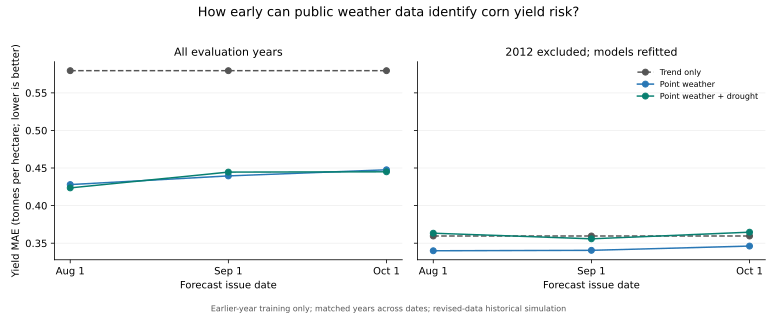
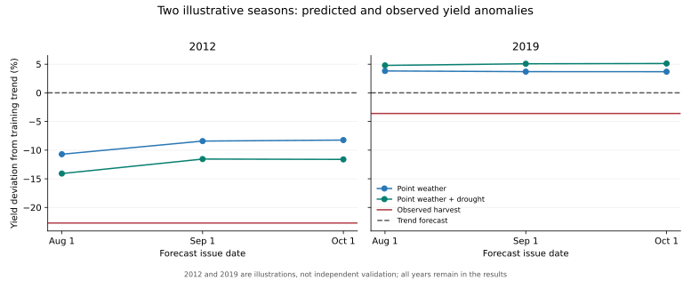

# Fixed-date corn yield nowcast

## Question and fixed specification

How accurately can public weather and drought data estimate final US corn yield at the end of August 1, September 1, and October 1? The three dates, two existing point-feature sets, and standardized Ridge(alpha=1) are fixed; there is no model, date, threshold, or hyperparameter search.

Training uses only earlier crop years, with at least 10 complete training seasons. Every fold refits the yield trend, scaling, and regression. The trend-only forecast uses the same training years. All dates and models share 26 complete seasons (2000–2025). Removing 2012 excludes it from training and evaluation and refits every fold.

## Information available at each issue

- POWER uses the existing 5-day publication-lag assumption. Both the observation date and recorded publication date must be within the cutoff. Every configured corn point must have finite temperature and precipitation and a known publication date for every expected day from April 1 through the lagged cutoff.
- USDM uses the existing Tuesday-map/Thursday-release rule. Every expected released map and every county in the first archived map's fixed corn-state universe must be present, finite, and published. Counties are averaged within states and states equally across the belt.
- Features retain the original study definitions: July heat degree-days above 29 °C, mean July maximum temperature, June–August rainfall, and April-to-issue peak D2-or-worse drought coverage. August 1 contains only the published portion of July. The points model uses heat, temperature, and rain; points+drought uses heat, rain, and peak drought.
- Missing observations or publication dates block the affected feature record. The comparison then takes the common complete years across all dates and models; missing inputs are never imputed as mild conditions.

## Results

| Sample | Issue | Model | Years | MAE (t/ha) | RMSE (t/ha) | R² vs trend | MAE improvement |
|---|---|---|---:|---:|---:|---:|---:|
| all_years | 08-01 | trend_only | 16 | 0.579 | 0.787 | +0.000 | +0.0% |
| all_years | 08-01 | points | 16 | 0.428 | 0.538 | +0.532 | +26.1% |
| all_years | 08-01 | points_drought | 16 | 0.424 | 0.512 | +0.576 | +26.9% |
| all_years | 09-01 | trend_only | 16 | 0.579 | 0.787 | +0.000 | +0.0% |
| all_years | 09-01 | points | 16 | 0.440 | 0.576 | +0.464 | +24.2% |
| all_years | 09-01 | points_drought | 16 | 0.445 | 0.563 | +0.488 | +23.3% |
| all_years | 10-01 | trend_only | 16 | 0.579 | 0.787 | +0.000 | +0.0% |
| all_years | 10-01 | points | 16 | 0.448 | 0.588 | +0.441 | +22.8% |
| all_years | 10-01 | points_drought | 16 | 0.445 | 0.566 | +0.482 | +23.2% |
| exclude_2012 | 08-01 | trend_only | 15 | 0.360 | 0.434 | +0.000 | +0.0% |
| exclude_2012 | 08-01 | points | 15 | 0.340 | 0.418 | +0.072 | +5.5% |
| exclude_2012 | 08-01 | points_drought | 15 | 0.363 | 0.450 | -0.073 | -1.0% |
| exclude_2012 | 09-01 | trend_only | 15 | 0.360 | 0.434 | +0.000 | +0.0% |
| exclude_2012 | 09-01 | points | 15 | 0.341 | 0.452 | -0.084 | +5.3% |
| exclude_2012 | 09-01 | points_drought | 15 | 0.356 | 0.481 | -0.226 | +1.0% |
| exclude_2012 | 10-01 | trend_only | 15 | 0.360 | 0.434 | +0.000 | +0.0% |
| exclude_2012 | 10-01 | points | 15 | 0.346 | 0.464 | -0.142 | +3.7% |
| exclude_2012 | 10-01 | points_drought | 15 | 0.365 | 0.489 | -0.266 | -1.4% |



R² versus trend is 1 − SSE(model) / SSE(fold-specific trend forecast). MAE and RMSE use final yield in tonnes per hectare. Earlier-year training and matched cohorts make the three issue dates comparable; a later issue is not guaranteed to improve either metric.

## Interpretation

The matched full run evaluates 16 harvests from 2010–2025, or 15 after excluding 2012. Points-plus-drought R² versus trend for August, September, and October is +0.576, +0.488, and +0.482. After removing 2012 and refitting the scores are -0.073, -0.226, and -0.266.

The points-plus-drought model retains positive R² versus trend at 0/3 dates without 2012. The weather-only August score without 2012 is +0.072. The small sample and sensitivity to a single exceptional season limit claims of stable early-season forecast usefulness. The stronger full-season county-weather result therefore cannot be assumed to hold for an earlier, available point-weather information set.

## Illustrative seasons



These two named seasons illustrate changing predictions and errors. They are not an acceptance test or a substitute for the full-year prediction CSV and the run that excludes 2012.

## County archive availability audit

County weather is excluded from the forecast features. Older county observations in this archive were published or rebuilt much later than their observation dates, including files dated 2022. Their publication dates are preserved; an assumed month lag is not used to manufacture earlier historical availability.

| Issue | Harvest years audited | Years with any published current-season county days |
|---|---:|---:|
| 08-01 | 26 | 3 |
| 09-01 | 26 | 4 |
| 10-01 | 26 | 4 |

The county coverage count is an upper-bound availability diagnostic, not certification of complete county coverage or first-release vintages. The feature/audit CSV preserves published-day counts and observation endpoints for every harvest/issue pair.

## Limits on interpretation

This is a historical simulation under reconstructed release rules, not a vintage-exact point-in-time backtest or a new untouched holdout. POWER may use revised reanalysis, USDM serves revised historical maps, and OWID/FAO yield labels have no original release vintages here. Earlier-year final yields stand in for the harvest estimates that would have been available then. The five-state weather belt is equally weighted while the target is national yield. A yield forecast does not establish information incremental to market expectations or an executable futures-return signal. No trading specification is changed.

## Reproduce

```bash
PYTHONPATH=src python analysis/corn_yield_nowcast.py
```

Use `--data-root` for an archived data directory and `--output-dir` for a separate destination. The runner needs no network or licensed prices. It writes the feature/coverage audit, per-year predictions, result table, report, and two SVG figures. Inspect the [feature/coverage audit](corn_yield_nowcast_features.csv), [per-year predictions](corn_yield_nowcast_predictions.csv), and [result table](corn_yield_nowcast_results.csv). Input fingerprints:

- `nasa_power_point_daily`: `bcc37518341aac582cb60980a81e125f2501241388d7b2e1089cfba210a99c04`
- `nclimgrid_county_daily`: `cacd6bf7ea731e330ae238e20cae08cab88924929da00c28380e41e6813ea04c`
- `usdm_county_drought`: `7a95532a26652e00566fe32d82e3fdbe7c95513c876581e11ea71be9dce215fa`
- `owid_yields_annual`: `d7f57022ae166e30c136ba81527060b9fccca075e59ccd8d3796f3b783c32a0d`
- `config/sources.yaml`: `c7e6d521158dc5488520d52ac242190cf8bd3d4979d6ecebedcb74628206ee98`
- `config/geography.yaml`: `0d1884d0046e481b3e3bf9c316bb627139f902c2dfd144e7a9b9f78d578522c8`
