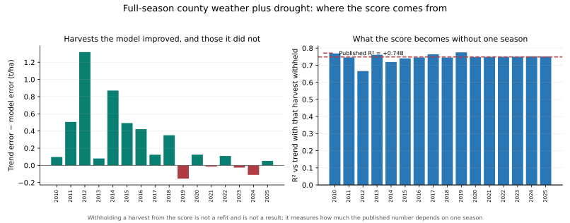

# Which corn harvests carry the yield scores

## What this decomposes, and what it cannot do

The forward and nowcast evaluations each publish one score per feature set over sixteen test harvests. This report takes those prediction files unchanged and asks which seasons the aggregates rest on. It fits nothing, tunes nothing, and selects nothing.

Withholding a harvest from a score is **not** the `exclude_2012` sample. That sample drops the season from training as well and refits every fold, so it is a different experiment with a different answer. Removing a year here only measures how much a published number depends on one observed outcome. Every such row discards real evidence, so none of them is a score to quote.

Strata are descriptive cuts. Tercile boundaries come from the scored test years themselves, which is acceptable for asking which seasons a model helps in only because nothing is selected on the result. Each bucket carries its own trend denominator, so its R² is not on a shared scale with any other bucket's; buckets below 4 seasons are left unscored.

## Per-harvest errors

Full-season `counties_drought`, all evaluation years. A positive gap is a harvest the weather model forecast more accurately than the training-only trend.

| Year | Observed (t/ha) | Trend (t/ha) | Model (t/ha) | Observed dev. | Model error | Trend error | Gap | Share of model SSE |
|---|---:|---:|---:|---:|---:|---:|---:|---:|
| 2010 | 9.58 | 10.22 | 10.12 | -6.3% | +0.546 | +0.643 | +0.097 | 12.0% |
| 2011 | 9.21 | 10.17 | 9.66 | -9.4% | +0.446 | +0.951 | +0.505 | 8.0% |
| 2012 | 7.73 | 10.00 | 8.68 | -22.7% | +0.952 | +2.271 | +1.318 | 36.4% |
| 2013 | 9.92 | 9.41 | 9.49 | +5.4% | -0.432 | -0.512 | +0.080 | 7.5% |
| 2014 | 10.73 | 9.59 | 10.46 | +11.9% | -0.268 | -1.138 | +0.870 | 2.9% |
| 2015 | 10.57 | 9.95 | 10.44 | +6.2% | -0.127 | -0.619 | +0.492 | 0.6% |
| 2016 | 10.96 | 10.19 | 10.61 | +7.6% | -0.352 | -0.773 | +0.421 | 5.0% |
| 2017 | 11.08 | 10.46 | 10.59 | +5.9% | -0.498 | -0.622 | +0.124 | 10.0% |
| 2018 | 11.07 | 10.71 | 11.08 | +3.4% | +0.012 | -0.362 | +0.351 | 0.0% |
| 2019 | 10.51 | 10.91 | 11.06 | -3.6% | +0.547 | +0.393 | -0.154 | 12.0% |
| 2020 | 10.76 | 10.95 | 10.83 | -1.8% | +0.071 | +0.196 | +0.125 | 0.2% |
| 2021 | 11.09 | 11.04 | 11.16 | +0.5% | +0.067 | -0.054 | -0.013 | 0.2% |
| 2022 | 10.88 | 11.16 | 11.05 | -2.5% | +0.172 | +0.281 | +0.109 | 1.2% |
| 2023 | 11.13 | 11.23 | 11.26 | -0.9% | +0.132 | +0.106 | -0.026 | 0.7% |
| 2024 | 11.25 | 11.33 | 11.44 | -0.7% | +0.189 | +0.078 | -0.110 | 1.4% |
| 2025 | 11.71 | 11.43 | 11.49 | +2.4% | -0.220 | -0.272 | +0.052 | 1.9% |



## Single-harvest influence

`Sign flips` counts how many single-season removals move R² across zero. A positive aggregate that flips when any one harvest is withheld is not a stable positive.

| Study | Sample | Issue | Feature set | Years | R² vs trend | Min after one removal | Max after one removal | Most load-bearing | R² without it | Sign flips |
|---|---|---|---|---:|---:|---:|---:|---:|---:|---:|
| forward | all_years | — | points | 16 | +0.441 | +0.274 | +0.502 | 2012 | +0.274 | 0 |
| forward | all_years | — | counties | 16 | +0.662 | +0.535 | +0.692 | 2012 | +0.535 | 0 |
| forward | all_years | — | counties_drought | 16 | +0.748 | +0.666 | +0.775 | 2012 | +0.666 | 0 |
| forward | all_years | — | points_drought | 16 | +0.503 | +0.220 | +0.599 | 2012 | +0.220 | 0 |
| forward | exclude_2012 | — | points | 15 | -0.142 | -0.288 | +0.030 | 2014 | -0.288 | 1 |
| forward | exclude_2012 | — | counties | 15 | +0.335 | +0.139 | +0.397 | 2011 | +0.139 | 0 |
| forward | exclude_2012 | — | counties_drought | 15 | +0.476 | +0.333 | +0.525 | 2011 | +0.333 | 0 |
| forward | exclude_2012 | — | points_drought | 15 | -0.230 | -0.335 | -0.086 | 2014 | -0.335 | 0 |
| nowcast | all_years | 08-01 | points | 16 | +0.532 | +0.326 | +0.591 | 2012 | +0.326 | 0 |
| nowcast | all_years | 08-01 | points_drought | 16 | +0.576 | +0.272 | +0.655 | 2012 | +0.272 | 0 |
| nowcast | all_years | 09-01 | points | 16 | +0.464 | +0.311 | +0.528 | 2012 | +0.311 | 0 |
| nowcast | all_years | 09-01 | points_drought | 16 | +0.488 | +0.194 | +0.588 | 2012 | +0.194 | 0 |
| nowcast | all_years | 10-01 | points | 16 | +0.441 | +0.274 | +0.502 | 2012 | +0.274 | 0 |
| nowcast | all_years | 10-01 | points_drought | 16 | +0.482 | +0.178 | +0.576 | 2012 | +0.178 | 0 |
| nowcast | exclude_2012 | 08-01 | points | 15 | +0.072 | -0.048 | +0.162 | 2014 | -0.048 | 1 |
| nowcast | exclude_2012 | 08-01 | points_drought | 15 | -0.073 | -0.176 | +0.076 | 2011 | -0.176 | 2 |
| nowcast | exclude_2012 | 09-01 | points | 15 | -0.084 | -0.221 | +0.095 | 2014 | -0.221 | 1 |
| nowcast | exclude_2012 | 09-01 | points_drought | 15 | -0.226 | -0.380 | -0.075 | 2010 | -0.380 | 0 |
| nowcast | exclude_2012 | 10-01 | points | 15 | -0.142 | -0.288 | +0.030 | 2014 | -0.288 | 1 |
| nowcast | exclude_2012 | 10-01 | points_drought | 15 | -0.266 | -0.374 | -0.121 | 2014 | -0.374 | 0 |

## Strata

Full-season `counties_drought`, all evaluation years.

Buckets are not contiguous, so `Span` is the first and last season a bucket contains rather than a range; `Seasons` lists them.

| Dimension | Bucket | Span | n | MAE (t/ha) | Trend MAE (t/ha) | R² vs trend | Seasons |
|---|---|---|---:|---:|---:|---:|---|
| Harvest above or below trend | shortfall | 2010–2024 | 8 | 0.382 | 0.615 | +0.735 | 2010;2011;2012;2019;2020;2022;2023;2024 |
| Harvest above or below trend | surplus | 2013–2025 | 8 | 0.247 | 0.544 | +0.777 | 2013;2014;2015;2016;2017;2018;2021;2025 |
| First or second half of the test years | early | 2010–2017 | 8 | 0.453 | 0.941 | +0.782 | 2010;2011;2012;2013;2014;2015;2016;2017 |
| First or second half of the test years | late | 2018–2025 | 8 | 0.176 | 0.218 | +0.115 | 2018;2019;2020;2021;2022;2023;2024;2025 |
| Tercile of absolute deviation from trend | high | 2010–2016 | 6 | 0.449 | 1.066 | +0.815 | 2010;2011;2012;2014;2015;2016 |
| Tercile of absolute deviation from trend | mid | 2013–2019 | 4 | 0.372 | 0.472 | +0.215 | 2013;2017;2018;2019 |
| Tercile of absolute deviation from trend | low | 2020–2025 | 6 | 0.142 | 0.164 | +0.336 | 2020;2021;2022;2023;2024;2025 |
| Tercile of peak belt severe-drought coverage | mid | 2010–2025 | 4 | 0.321 | 0.516 | +0.615 | 2010;2011;2020;2025 |
| Tercile of peak belt severe-drought coverage | high | 2012–2024 | 6 | 0.324 | 0.550 | +0.786 | 2012;2013;2021;2022;2023;2024 |
| Tercile of peak belt severe-drought coverage | low | 2014–2019 | 6 | 0.300 | 0.651 | +0.743 | 2014;2015;2016;2017;2018;2019 |
| Tercile of county July heat degree-days | mid | 2010–2025 | 5 | 0.287 | 0.352 | +0.318 | 2010;2013;2021;2022;2025 |
| Tercile of county July heat degree-days | high | 2011–2020 | 5 | 0.503 | 0.887 | +0.750 | 2011;2012;2017;2019;2020 |
| Tercile of county July heat degree-days | low | 2014–2024 | 6 | 0.180 | 0.513 | +0.891 | 2014;2015;2016;2018;2023;2024 |

## Interpretation

The full-season `counties_drought` score of +0.748 spans +0.666 to +0.775 when any single harvest is withheld, with 2012 the most load-bearing season at +0.666 without it. The matched refitted `exclude_2012` run scores +0.476 and spans +0.333 to +0.525 under the same treatment. Neither run contains a single-season removal that changes the sign of its score, so the full-season result is not an artifact of one harvest. That is a narrower claim than the headline R² invites and it is the one the evidence supports.

Across all evaluation years, the seasons deviating most from trend score +0.815 against a trend forecast already missing by 1.066 t/ha, while the calmest third scores +0.336 against a trend error of only 0.164 t/ha.
Across the refitted run without 2012, the seasons deviating most from trend score +0.596 against a trend forecast already missing by 0.652 t/ha, while the calmest third scores -0.452 against a trend error of only 0.136 t/ha.
The weather model earns its score in the seasons that went wrong and adds little or nothing in the ones that did not. For a measure of supply risk that is the expected shape rather than a defect, but it does mean the aggregate R² describes performance on a sample whose composition of extreme seasons is doing much of the work, and it should not be read as accuracy in a typical year.
The severity buckets mix both directions, and the model is close to symmetric across them: +0.735 on the harvests below trend against +0.777 on those above it. It is behaving as a two-sided weather-to-yield measure rather than only as a drought-damage detector.

The era split is a statement about the denominator rather than about decay. Where the recent half's harvests sat close to trend, the trend forecast was already accurate and there was correspondingly little error available to remove; a low R² there is weak evidence of a model that stopped working.

This is a decomposition of retrospective, revised-data evaluations. It adds no new information set, no in-season claim, no futures-return result, and no untouched holdout. The target remains national US yield against equally weighted five-state weather.

## Reproduce

```bash
PYTHONPATH=src python analysis/corn_yield_strata.py
```

Run the forward and nowcast evaluations first; this script reads their prediction CSVs. Use `--data-root` for an archived data directory, `--output-dir` for a separate destination, and `--skip-weather-strata` to omit the drought and heat cuts. Inspect the [per-harvest errors](corn_yield_strata_per_year.csv), [influence rows](corn_yield_strata_influence.csv), [influence summary](corn_yield_strata_influence_summary.csv), and [strata scores](corn_yield_strata_buckets.csv). Input fingerprints:

- `corn_yield_forward_validation_predictions.csv`: `8a438e3ff4ec73cedbbaccb91d443eb0e6e1248f76649c24d0b17496372a406f`
- `corn_yield_nowcast_predictions.csv`: `7f822472a211f76f4178e30c48502b6c3d1f29c37df7dbcfcf1d0cbcfe466010`
